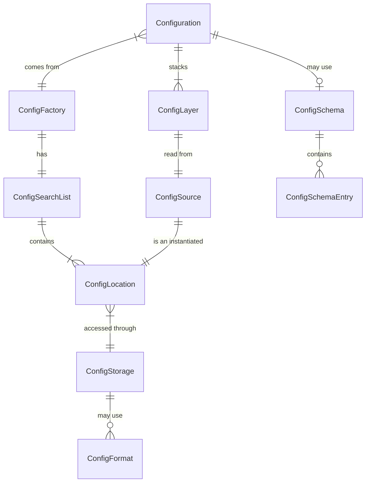

# 2.1 How it Works

To get library operation started, we need a lot of preparation and settings.
These are collected in a factory builder, `ConfigFactoryBuilder`,
which then builds a `ConfigFactory` with specific settings.

### Self-Configuration
Before the ConfigFactory is fully operational, it may perform "self-configuration".
During `build()`, the factory searches the classpath for the component file
`.config/<company>/<application>/mconfig.properties` of the company and application it is built for.

This feature is enabled by default. It can be disabled by setting the `ENABLE_SELF_CONFIGURATION` flag to `false` in the `ConfigFactoryBuilder`.

Settings found in this file are used to populate the internal `ConfigFactorySettings`, filling in
features that the code has not set. Because the file is bound to company and application, every
component using mConfig configures only its own factories. Security-relevant switches such as
`ALLOW_MCONFIG_RUNTIME_SETTINGS` can only be set in code. The global file
`.config/metabit/mConfig/mconfig.properties` is deprecated and will be removed before 0.9.0.
See [Self-configuration per component](25_config_features.md#self-configuration-per-component).

The ConfigFactory in turn produces individual Configuration objects.

### 2-Phase Bootstrapping (Post-Initialization)
For advanced self-configuration, mConfig supports a 2-phase bootstrapping process. Once the `ConfigFactory` is fully initialized and the initial configuration stack is built, a `postInit` hook is called on all registered `ConfigStorageInterface`, `ConfigSecretsProviderInterface`, `ConfigFactoryComponent`, and `ConfigLoggingInterface` modules. Storages receive a `BootstrapConfigContext`; the other module types receive the `ConfigFactory`.

The execution order for the `postInit` hook is deterministic:
1.  **`ConfigStorageInterface`**: Storages read their own connection settings via `BootstrapConfigContext.getRestrictedConfig(name, scopes)`, limited to scopes they do not serve themselves.
2.  **`ConfigSecretsProviderInterface`**: Secrets providers can fetch credentials from the now-ready storages.
3.  **`ConfigFactoryComponent`**: Administrative components (e.g., schema exporters) perform their tasks.
4.  **`ConfigLoggingInterface`**: The logger refines its configuration (e.g., remote endpoints) using the complete stack.

This allows modules to use the fully functional `ConfigFactory` to retrieve their own settings from any available source (including other modules) or perform post-startup administrative tasks. For example, a cloud storage module could use `postInit` to fetch its access credentials from a secrets provider that was initialized in the first phase, or a schema exporter component could automatically write discovered schemas to a specific directory. Advanced logging implementations can also use this hook to refine their remote endpoints or tokens using the fully resolved configuration hierarchy.

That's the startup phase; once that is done, you use the Configuration objects.

---
## Concept: Scopes
mConfig uses the concept of hierarchical **Scopes**. This determines the priority and visibility of configuration entries across different environments.

See the dedicated **[Scopes](20_scopes.md)** section for a detailed explanation of the scope hierarchy and its importance.

### Default scope and source hierarchy

Resolution priority between different storage types (within the same scope) is deterministic.

**Default Storage Priority (Highest to Lowest):**
1. `RAM` (In-memory overrides)
2. `secrets` (Encrypted/sensitive data)
3. `vault` (HashiCorp Vault)
4. `aws-secrets` (AWS Secrets Manager)
5. `files` (Local filesystem)
6. `registry` (Windows Registry)
7. `registryjni` (Windows Registry JNI)
8. `zookeeper` (ZooKeeper module)
9. `JAR` (Classpath resources/defaults)

Storages not in this list, such as `kubernetes` and `kubernetes-fabric8`, rank below all listed ones.
The ConfigMap and Secret directories the Kubernetes modules mount into the `CLUSTER` scope are read
through `files` and rank as such.

Use `STORAGE_TYPE_PRIORITIES` to change this order within a scope.

### Filesystem search paths (FileConfigStorage)

The lists below show the default candidate search paths *as considered for the search list*.
Earlier entries are preferred for **creation**; later entries override earlier ones
within the same scope. `SUB_PATH` (if set) is appended to the application paths.
`ADDITIONAL_*_DIRECTORIES` are prepended to their scope lists.

> **Candidate Search List & Dynamic Discovery**: `getSearchList()` contains all candidate `ConfigLocation`s considered by active storage providers (e.g., standard OS directories). Candidate directories are retained in the search list even if they do not exist on disk at initialization time. When a missing directory or configuration file is created later while the application runs, background change checkers detect it and dynamically attach it to active configurations. Conversely, `configuration.getSourceLocations()` lists only the locations that currently exist and contributed active data layers.

> **Optional Company Segment**: `<company>` omitted if `COMPANY_NAME` blank/null/whitespace (recommended but can be intentionally left blank for app-only paths). Examples below show both forms where applicable.

**Linux (and most Unix-like systems)**

HOST scope:
- `$XDG_CONFIG_DIRS` (default `/etc/xdg`), each entry: `<dir>/<app>`
- `/etc/opt/[<company>/]<app>/<subPath>`
- `/etc/opt/<app>/<subPath>`
- `/usr/local/etc/<app>/<subPath>`
- `/etc/<app>/<subPath>`
- `/etc/opt/[<company>/]` (broader HOST scope)
- `/etc/opt/` (broader HOST scope)
- `/usr/local/etc/` (broader HOST scope)
- `/etc/` (broader HOST scope)

USER scope:
- `$XDG_CONFIG_HOME/[<company>/]<app>/<subPath>` (if set)
- `~/.config/[<company>/]<app>/<subPath>`
- `~/.<app>/<subPath>`
- 
SESSION scope:
- `$PWD/.config/<app>/<subPath>`

**Windows**

SESSION scope:
- `%CD%\\.config\\<app>\\<subPath>`
- `%CD%` (legacy side-by-side .ini, .properties, etc.)

USER scope:
- `%XDG_CONFIG_HOME%\\<app>\\<subPath>` (if set)
- `%AppData%\\[<company>\\<]<app>\\<subPath>`
- `%LocalAppData%\\[<company>\\<]<app>\\<subPath>`
- `%UserProfile%\\.config\\<app>\\<subPath>`

APPLICATION scope:
- `<appDir>\\.config`
- `<appDir>`

HOST scope:
- `%ProgramData%\\[<company>\\<]<app>`
- `%AllUsersProfile%\\[<company>\\<]<app>`
- `%ProgramData%\\[<company>\\<]` (broader HOST scope)
- `%ProgramData%` (broader HOST scope)
- `%AllUsersProfile%\\[<company>\\<]` (broader HOST scope)
- `%AllUsersProfile%` (broader HOST scope)

**macOS (experimental)**

USER scope:
- `$XDG_CONFIG_HOME/[<company>/]<app>/<subPath>` (if set)
- `~/Library/Application Support/[<company>/]<app>/<subPath>`
- `~/Library/Preferences/[<company>/]<app>/<subPath>`
- `~/.<app>/<subPath>`

HOST scope:
- `/Library/Application Support/[<company>/]<app>/<subPath>`
- `/Library/Preferences/[<company>/]<app>/<subPath>`

APPLICATION scope:
- `<appDir>/.config`
- `<appDir>`

SESSION scope:
- `$PWD/.config/<app>/<subPath>`

**Android (experimental)**

APPLICATION scope:
- `/data/data/<app>/files/.config/<subPath>`
- `/data/data/<app>/files/<subPath>`

USER scope:
- `/data/data/<app>/files/<subPath>`
- `/storage/emulated/0/Android/data/<app>/files/.config/<subPath>` (if `EXTERNAL_STORAGE` set)
- `/storage/emulated/0/Android/data/<app>/files/<subPath>`

SESSION scope:
- `/data/data/<app>/cache/.config/<subPath>`
- Plus Linux-style fallbacks.

**Fallback (unknown OS)**

USER scope:
- `~/.<app>/<subPath>`

HOST scope:
- `$PWD/.config/<app>/<subPath>`


## The Process

### Layered Stack
When you ask for a ConfigEntry (or just its value) by providing a key, 
the library starts searching.
The normal method is using a layered stack, sorted by the aforementioned scopes.

At top, if enabled, is the cache layer, at RUNTIME scope.
Below it follow the other scopes, down to the PRODUCT scope, 
where you can find the defaults layer.

For each layer, the respective configuration source is asked whether it has
an entry matching the key. The topmost layer which has a valid entry wins,
and you get the ConfigEntry it has found.

If you asked for just the value, not the full ConfigEntry, then the library
tries to return the data found in the Java class matching the type of
value you asked for (e.g. Boolean, Integer, byte array).

### validation 
Note the mention of **valid** data.
You can, and should, provide a ConfigSchema which declares the expected
entries, and some information about them.

#### Schema Components
A schema entry typically includes:
- **Key**: The hierarchical name of the configuration entry.
- **Type**: The expected data type (e.g., `STRING`, `NUMBER`, `BOOLEAN`, `BYTES`, `DATE`, `DURATION`).
- **Default Value**: A fallback value used if the entry is missing from all other layers.
- **Description**: Documentation for the entry, used in reports and UI.
- **Flags**: Metadata like `MANDATORY`, `SECRET`, or `HIDDEN`.
- **Validation Rules**: Patterns or ranges (e.g., regex for strings, min/max for numbers) to ensure data integrity.

#### The Validation Process
When a configuration is accessed:
1. **Discovery**: The library searches for the key through the layered stack.
2. **Type Enforcement**: If a schema is active, the raw data from a `ConfigSource` is converted to the type specified in the schema. If conversion fails (e.g., "abc" for a `NUMBER`), the entry is considered invalid, and the search continues in lower priority layers.
3. **Constraint Checking**: The converted value is checked against validation rules (regex, ranges, enums).
4. **Outcome**:
   - **Valid**: The entry is returned and potentially cached.
   - **Invalid**: By default, the library logs a warning and skips the invalid entry, continuing the search in lower priority layers.
   - **Missing Mandatory**: If a `MANDATORY` entry is not found in any layer (including the default layer), a `ConfigException` is thrown upon access.

#### Schema Activation
When a `ConfigSchema` is activated for a `Configuration`:
- It populates the **Default Layer** (PRODUCT scope) with any default values defined in the schema.
- It provides the metadata required for automated documentation and schema export.
- It acts as a gatekeeper for all data entering the `Configuration` facade, ensuring type safety.

## Changes & Monitoring

There's two different aspects to changes.

First, getting notifications when the *value* of a config entry changes.
This is actively checking, even polling, for changes, to notify your code about
such events. It checks across different ConfigSources, formats, and the like.

mConfig provides a subscription mechanism via `subscribeToUpdates(Consumer<ConfigLocation>)`. 
This allows applications (and tools like the `mconfig monitor` command) to react
to configuration changes in real-time.

Second, the automated cache flush for some config sources. For most, reading is
not much effort; but certain ones - especially files and parsing their formats -
are not that cheap. So these are read, parsed, and then cached for some time.

But the cache should not stay indefinitely, it needs to detect changes and/or
refresh automatically. → `ConfigFeature.UPDATE_CHECK_FREQUENCY_MS`


## Behind the Scenes

mConfig uses these concepts for separation of concerns:

* **ConfigStorage** (`ConfigStorageInterface`) is an access medium: filesystem, classpath/JAR resources,
  Windows registry, environment variables, network services such as ZooKeeper or Vault.
  It provides the technical access. Examples: `FileConfigStorage`, `JARConfigSource`, `EnvVarConfigStorage`,
  `WindowsRegistryConfigSource`, `VaultConfigStorage`, `SchemaDefaultConfigStorage`.

* **ConfigFormat** (`ConfigFormatInterface`) is how a configuration is encoded inside a blob-like storage:
  Java properties, JSON, YAML, TOML, INI, and so on. Files, specifically, come in a number of different
  formats; the format handles the actual parsing and writing.
  The Windows registry is a storage, not a format; like environment variables and Vault, it converts
  its own value types and needs no format.

* **ConfigLocation**: a place where a configuration may be found: storage, storage-specific handle
  (e.g. a directory), and scope. The `ConfigSearchList` of a factory is a list of these.

* **ConfigSource**: a `ConfigLocation` that has been instantiated, so there is a layer to it.

* **ConfigLayer**: the concrete data read from one location, mapped to hierarchical keys.
  For blob-like storages (files, ZooKeeper BLOBs, JAR resources) a format produces the layer;
  storages with structured data of their own (Windows registry, environment variables, Vault)
  produce it themselves.

**Module naming**: a module named `mConfigSource<Name>` (e.g. `mConfigSourceFilesystem`,
`mConfigSourceVault`) provides a storage, despite "Source" in its name.



**Configuration** : the API interface to access configurations; produces/keeps ConfigEntry instances,
and provides simple access to the values.
A Configuration is built by going through the search list of its ConfigFactory; for each location,
the storage adds the layers it finds, sorted by scope.

*A Configuration object is a way to access configurations in a uniform way.*

#### Anchor
The ConfigFactoryBuilder gathers and combines all the settings.
It creates a **ConfigFactoryInstanceContext** and a ConfigFactory to use it.

The ConfigFactoryInstanceContext is passed to several objects the ConfigFactory
uses, so they can get their respective features, settings, access to a logger,
and so on - it is an internally shared resource.


## Security and Secrets
mConfig has built-in support for sensitive data such as passwords, API keys, and private certificates.

### Secret Redaction
Config entries marked as secrets in the `ConfigSchema` are automatically handled with care:
- Their `toString()` representation is redacted (`[REDACTED]`). (using stars could be ambiguous)
- They are stored in specialized `SecretConfigEntryLeaf` objects.
- In-memory storage uses `byte[]` or `char[]` to allow for clearing the data after use.

### The SecretValue API
For programmatically accessing secrets, mConfig provides the `SecretValue` interface. 
This allows retrieving the sensitive data without it being accidentally converted to a standard `String` that might linger in the Java String Pool.

```java
SecretValue password = config.getSecret("database/password");
byte[] rawBytes = password.getValue();
// ... use and then potentially clear the bytes
```

## Binary Data (BLOBs)
Not all configuration is text-based. mConfig supports Binary Large Objects (BLOBs) for things like license files, binary keys, or certificates.

### Hierarchical BLOBs
In modern formats like JSON and YAML, binary data can be embedded directly.
- **YAML** uses the standard `!!binary` tag.
- **JSON** uses Base64 encoded strings. If a `ConfigSchema` is provided that marks a key as `BYTES` type, mConfig will automatically decode the Base64 string into a byte array.

### Flat Binary Files
For legacy support or specific use cases, an entire file can be treated as a single binary blob. This uses the `binary_file` format and is accessed via the empty string key (`""`).

```java
// Retrieving an entire .bin file as a single blob
Configuration licenseCfg = factory.getConfig("license");
byte[] licenseData = licenseCfg.getBytes("");
```


### Failure Handling

If there is no ConfigEntry found at any layer, and no specific default is found,
the reaction is determined by the ConfigFeature flags set.

(a) return a generic default value depending on the type
(b) throw ConfigException (runtime exception type)
(c) return "null" as ConfigEntry handle, your own code wants to handle the details.
— this will still cause an exception if you are asking for the value only. 

It is recommended, though, that you provide for each config entry you are reading
a default value which is sensible and useful in the context of your use case. 


